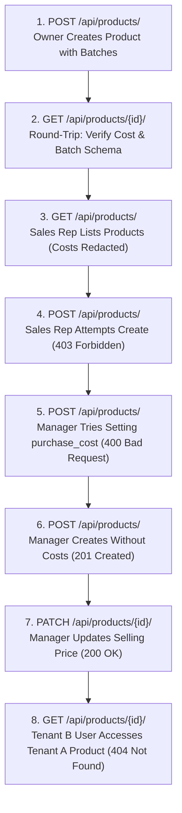
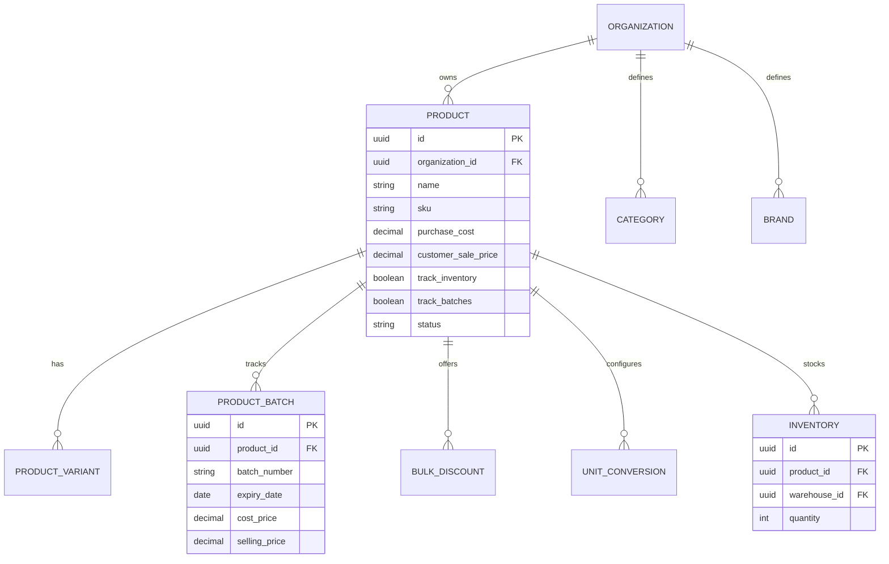

# RIINOX Products App — Interactive Manual Testing Guide & Payload Reference

> **Target Service**: RIINOX Products API (`/api/products/`)  
> **Relevant Specifications**: PRD §10, §14, §16, §28, §30, §44, §52, §55  
> **Target Audience**: QA Engineers, Backend Developers, Frontend Integrators, Security Auditors  

---

## 1. Quick Answers to Crucial Payload & Security Questions

> [!IMPORTANT]
> ### 1. How is Multi-Tenant Isolation Enforced on `/api/products/`?
> * **Automatic Tenant Scoping**: Every product query automatically scopes to the authenticated user's active organization memberships via `Product.objects.for_user(request.user)`.
> * **Multi-Tenant Header / Query Param**: For users belonging to multiple organizations, pass `?organization=<UUID>` or the `X-Organization-ID: <UUID>` header to explicitly scope to a specific workspace.
> * **Zero Cross-Tenant Leakage**: Attempting to read, update, or delete a product belonging to another organization returns HTTP `404 Not Found` (never revealing the existence of another tenant's records). Attempting to create a product specifying another organization's ID returns HTTP `403 Forbidden`.

> [!TIP]
> ### 2. What Happens to Costs (`purchase_cost`, `vendor_sale_cost`) for Non-Financial Staff?
> * **Field-Level Dynamic Redaction (PRD §55)**:
>   * Users holding `VIEW_PRODUCT_COSTS` (e.g., **Owner**, **Administrator**, **Accountant**, **Finance Officer**) receive full monetary visibility: `purchase_cost` and `vendor_sale_cost` are present in `GET` responses.
>   * Users without this permission (e.g., **Sales Representative**, **Manager**, **Cashier**) have those fields **completely stripped from the JSON response**.
>   * Batch-level `cost_price` is also dynamically redacted on nested `batches` arrays.
> * **Frontend Tip**: Never assume `purchase_cost` exists in the response object; check for field presence before rendering cost columns in UI tables.

> [!NOTE]
> ### 3. Can a Store Manager Create Products? Can They Set Purchase Costs?
> * **Product Creation & Price Edits Allowed**: Store Managers hold `CREATE_PRODUCT`, `EDIT_PRODUCT`, and `EDIT_SELLING_PRICE`. They can create products and adjust customer selling prices.
> * **Cost Tampering Blocked**: Store Managers do **NOT** hold `EDIT_PRODUCT_COSTS`. If a manager includes `purchase_cost` or `vendor_sale_cost` in a `POST` or `PATCH` request, the serializer rejects the request with HTTP `400 Bad Request`:
>   ```json
>   {
>     "code": "VALIDATION_ERROR",
>     "detail": "Invalid input.",
>     "errors": {
>       "purchase_cost": ["You do not have permission to edit product costs in this organization."]
>     }
>   }
>   ```

> [!TIP]
> ### 4. How are Initial Opening Stock and Batches Handled on Product Creation?
> * **Zero Opening Stock by Default**: If `quantity_in_stock` and `warehouse_id` are omitted, the product is created in the catalog without creating inventory records.
> * **Atomic Provisioning**: If `quantity_in_stock > 0` and `warehouse_id` are supplied, the backend invokes [`create_opening_stock()`](file:///c:/Users/solomonXuche/Documents/Programming/RIINOX/core/applications/inventory/services.py), creating an `Inventory` record and recording an initial `InventoryLedgerEntry` inside an atomic transaction.

---

## 2. Comprehensive Payload Field Dictionary

### 2.1 Product Catalog Header (`POST /api/products/` & `PATCH /api/products/{id}/`)

| Field Name | Type | Required? | Default | Where to get UUID | Purpose & Business Rules |
| :--- | :--- | :--- | :--- | :--- | :--- |
| **`organization`** | `UUID` | **Required (POST)** | None | `GET /api/users/organizations/` | Multi-tenant boundary. The authenticated caller must have an active membership with `CREATE_PRODUCT`. |
| **`name`** | `String` (max 255) | **Required (POST)** | None | User input | Commercial product display name (e.g. `"Paracetamol 500mg Tablets"`). |
| **`sku`** | `String` (max 100) | **Required (POST)** | None | User input / Barcode scan | Unique Stock Keeping Unit identifier within the organization. |
| **`customer_sale_price`** | `Decimal` (String) | Optional | `"0.00"` | User input | Retail / selling price charged to customers. Requires `EDIT_SELLING_PRICE` to modify. |
| **`purchase_cost`** | `Decimal` (String) | Optional | `"0.00"` | Supplier quote | Unit procurement cost. **Requires `EDIT_PRODUCT_COSTS`** to set or edit. Redacted if caller lacks `VIEW_PRODUCT_COSTS`. |
| **`vendor_sale_cost`** | `Decimal` (String) | Optional | `"0.00"` | Supplier wholesale list | Suggested vendor wholesale benchmark cost. Requires `EDIT_PRODUCT_COSTS`. |
| **`category`** | `UUID` | Optional | `null` | `GET /api/products/categories/` | Product classification grouping. Must belong to the same organization. |
| **`brand`** | `UUID` | Optional | `null` | `GET /api/products/brands/` | Manufacturer or brand entity. Must belong to the same organization. |
| **`barcode`** | `String` (max 100) | Optional | `null` | Barcode scan | EAN-13, UPC-A, or internal barcode. |
| **`description`** | `String` | Optional | `""` | User input | Rich text or plain description of product specifications. |
| **`quality_grade`** | `String` | Optional | `""` | User input | Grade classification (e.g. `"Grade A"`, `"Premium"`). |
| **`unit_of_measurement`** | `String` | Optional | `"pcs"` | User input | Base measurement unit (e.g. `"pcs"`, `"kg"`, `"box"`, `"liter"`). |
| **`product_type`** | `String` | Optional | `"standard"` | Choices | Type of item: `"standard"`, `"service"`, or `"composite"`. |
| **`tax_config`** | `String` | Optional | `"none"` | Choices | Taxation mode: `"none"`, `"inclusive"`, or `"exclusive"`. |
| **`tax_rate`** | `Decimal` (String) | Optional | `"0.00"` | User input | Applicable tax rate percentage (e.g. `"7.50"` for VAT). |
| **`track_inventory`** | `Boolean` | Optional | `true` | UI checkbox | When `true`, stock levels and inventory ledger movements are tracked. |
| **`track_batches`** | `Boolean` | Optional | `false` | UI checkbox | When `true`, batch numbers and expiration dates must be tracked. |
| **`minimum_stock_level`**| `Integer` | Optional | `0` | User input | Threshold below which low-stock notifications are triggered. |
| **`low_stock_alert_unit`** | `String` | Optional | `"pcs"` | User input | Unit for stock alert threshold. |
| **`quantity_in_stock`** | `Integer` | Optional (POST only) | `0` | Physical stock count | Initial opening stock quantity (write-only). |
| **`warehouse_id`** | `UUID` | Optional (POST only) | `null` | `GET /api/warehouse/warehouses/` | Destination warehouse for opening stock (write-only). |
| **`batches`** | `Array` | Optional | `[]` | See 2.2 below | Array of initial product batches. |
| **`bulk_discounts`** | `Array` | Optional | `[]` | See 2.3 below | Array of quantity-based wholesale discounts. |
| **`unit_conversions`** | `Array` | Optional | `[]` | See 2.4 below | Array of secondary unit multipliers (e.g., carton = 24 pcs). |

---

### 2.2 Nested Batch Object (`batches[...]`)

| Field Name | Type | Required? | Default | Purpose & Business Rules |
| :--- | :--- | :--- | :--- | :--- |
| **`batch_number`** | `String` (max 100) | **Required** | None | Manufacturer batch / lot number (e.g., `"LOT-2026-X89"`). |
| **`expiry_date`** | `Date` (YYYY-MM-DD) | Optional | `null` | Expiration date for perishables or pharmaceuticals. |
| **`cost_price`** | `Decimal` (String) | Optional | `"0.00"` | Specific procurement cost for this batch. Redacted if caller lacks `VIEW_PRODUCT_COSTS`. |
| **`selling_price`** | `Decimal` (String) | Optional | `"0.00"` | Batch-specific selling price override. |

---

### 2.3 Nested Bulk Discount Object (`bulk_discounts[...]`)

| Field Name | Type | Required? | Default | Purpose & Business Rules |
| :--- | :--- | :--- | :--- | :--- |
| **`min_quantity`** | `Integer` | **Required** | None | Minimum purchase threshold required to activate discount (e.g. `10`). |
| **`discount_amount`** | `Decimal` (String) | **Required** | None | Fixed reduction or discounted price per unit. |

---

### 2.4 Nested Unit Conversion Object (`unit_conversions[...]`)

| Field Name | Type | Required? | Default | Purpose & Business Rules |
| :--- | :--- | :--- | :--- | :--- |
| **`unit_name`** | `String` (max 50) | **Required** | None | Secondary unit packaging name (e.g. `"Carton"`). |
| **`multiplier`** | `Decimal` (String) | **Required** | None | Multiplier converting to base unit (e.g. `"24.00"` means 1 Carton = 24 base units). |
| **`price_override`** | `Decimal` (String) | Optional | `null` | Optional pre-calculated packaged sale price override. |

---

## 3. Role & Permission Access Control Matrix

The table below outlines the exact permission enforcement across standard PRD system roles:

| Action / Capability | Permission Code | Owner / Admin | Manager | Sales Rep | Inventory Manager | Accountant |
| :--- | :--- | :---: | :---: | :---: | :---: | :---: |
| **List Products** | `VIEW_PRODUCTS` | :white_check_mark: Allowed | :white_check_mark: Allowed | :white_check_mark: Allowed | :white_check_mark: Allowed | :white_check_mark: Allowed |
| **Retrieve Product Details** | `VIEW_PRODUCTS` | :white_check_mark: Allowed | :white_check_mark: Allowed | :white_check_mark: Allowed | :white_check_mark: Allowed | :white_check_mark: Allowed |
| **View Purchase Costs** | `VIEW_PRODUCT_COSTS` | :white_check_mark: Visible | :x: **Redacted** | :x: **Redacted** | :x: **Redacted** | :white_check_mark: Visible |
| **Create Product** | `CREATE_PRODUCT` | :white_check_mark: Allowed | :white_check_mark: Allowed | :x: **Blocked (403)** | :x: **Blocked (403)** | :x: **Blocked (403)** |
| **Set Purchase Costs** | `EDIT_PRODUCT_COSTS` | :white_check_mark: Allowed | :x: **Blocked (400)** | :x: **Blocked (403)** | :x: **Blocked (403)** | :x: **Blocked (403)** |
| **Edit Selling Price** | `EDIT_SELLING_PRICE` | :white_check_mark: Allowed | :white_check_mark: Allowed | :x: **Blocked (403)** | :x: **Blocked (403)** | :x: **Blocked (403)** |
| **Update Product Metadata**| `EDIT_PRODUCT` | :white_check_mark: Allowed | :white_check_mark: Allowed | :x: **Blocked (403)** | :x: **Blocked (403)** | :x: **Blocked (403)** |
| **Archive / Delete Product**| `ARCHIVE_PRODUCT` | :white_check_mark: Allowed | :x: **Blocked (403)** | :x: **Blocked (403)** | :x: **Blocked (403)** | :x: **Blocked (403)** |

---

## 4. End-to-End Manual Testing Walkthrough

Follow these steps using cURL, Postman, or Swagger UI (`http://127.0.0.1:8000/api/docs/`).



---

### Step 1: Owner Creates Product with Batches (`POST /api/products/`)

#### Request:
```bash
curl -X POST "http://127.0.0.1:8000/api/products/" \
  -H "Authorization: Bearer <OWNER_ACCESS_TOKEN>" \
  -H "Content-Type: application/json" \
  -d '{
    "organization": "a1b2c3d4-e5f6-4789-b1c2-d3e4f5a6b7c8",
    "name": "Amoxicillin 500mg Capsules",
    "sku": "MED-AMX-500",
    "barcode": "8901234567890",
    "unit_of_measurement": "box",
    "track_inventory": true,
    "track_batches": true,
    "purchase_cost": "1200.00",
    "customer_sale_price": "2000.00",
    "minimum_stock_level": 20,
    "batches": [
      {
        "batch_number": "AMX-2026-B1",
        "expiry_date": "2027-12-31",
        "cost_price": "1200.00",
        "selling_price": "2000.00"
      }
    ]
  }'
```

#### Expected HTTP Response:
* **Status**: `201 Created`
* **Response Body**:
```json
{
  "id": "7f8e9d0c-1b2a-4345-a678-90abcdef1234",
  "visible": true,
  "name": "Amoxicillin 500mg Capsules",
  "sku": "MED-AMX-500",
  "barcode": "8901234567890",
  "unit_of_measurement": "box",
  "product_type": "standard",
  "tax_config": "none",
  "tax_rate": "0.00",
  "track_inventory": true,
  "track_batches": true,
  "purchase_cost": "1200.00",
  "vendor_sale_cost": "0.00",
  "customer_sale_price": "2000.00",
  "minimum_stock_level": 20,
  "organization": "a1b2c3d4-e5f6-4789-b1c2-d3e4f5a6b7c8",
  "batches": [
    {
      "id": "3b4c5d6e-7f8a-4901-b234-56cdef789012",
      "batch_number": "AMX-2026-B1",
      "expiry_date": "2027-12-31",
      "cost_price": "1200.00",
      "selling_price": "2000.00"
    }
  ],
  "bulk_discounts": [],
  "unit_conversions": []
}
```

#### Database State Verification:
Execute in PostgreSQL container (`docker compose -f docker-compose.local.yml exec postgres psql -U riinox -d riinox`):
```sql
-- 1. Verify product row in database
SELECT id, name, sku, purchase_cost, customer_sale_price, track_batches 
FROM products_product WHERE sku = 'MED-AMX-500';

-- 2. Verify batch row linked to product
SELECT id, batch_number, expiry_date, cost_price, selling_price 
FROM products_productbatch WHERE product_id = '7f8e9d0c-1b2a-4345-a678-90abcdef1234';
```

---

### Step 2: Round-Trip Verification (`GET /api/products/{id}/`)

#### Request:
```bash
curl -X GET "http://127.0.0.1:8000/api/products/7f8e9d0c-1b2a-4345-a678-90abcdef1234/" \
  -H "Authorization: Bearer <OWNER_ACCESS_TOKEN>"
```

#### Expected HTTP Response:
* **Status**: `200 OK`
* **Verification**: Read serializer succeeds without crashes; `purchase_cost` is `"1200.00"` and `batches` contains 1 element.

---

### Step 3: Sales Representative Lists Products — Cost Redaction Check

Login as a user with the **Sales Representative** role in the same organization.

#### Request:
```bash
curl -X GET "http://127.0.0.1:8000/api/products/" \
  -H "Authorization: Bearer <SALES_REP_ACCESS_TOKEN>"
```

#### Expected HTTP Response:
* **Status**: `200 OK`
* **Response Body**:
```json
{
  "count": 1,
  "next": null,
  "previous": null,
  "results": [
    {
      "id": "7f8e9d0c-1b2a-4345-a678-90abcdef1234",
      "name": "Amoxicillin 500mg Capsules",
      "sku": "MED-AMX-500",
      "customer_sale_price": "2000.00",
      "track_inventory": true,
      "batches": [
        {
          "id": "3b4c5d6e-7f8a-4901-b234-56cdef789012",
          "batch_number": "AMX-2026-B1",
          "expiry_date": "2027-12-31",
          "selling_price": "2000.00"
        }
      ]
    }
  ]
}
```
> [!IMPORTANT]
> Notice that `purchase_cost`, `vendor_sale_cost`, and batch `cost_price` are **completely absent** from the returned JSON payload.

---

### Step 4: Sales Representative Attempts Product Creation (Blocked)

#### Request:
```bash
curl -X POST "http://127.0.0.1:8000/api/products/" \
  -H "Authorization: Bearer <SALES_REP_ACCESS_TOKEN>" \
  -H "Content-Type: application/json" \
  -d '{
    "organization": "a1b2c3d4-e5f6-4789-b1c2-d3e4f5a6b7c8",
    "name": "Illicit Product",
    "sku": "MED-ILL-001",
    "customer_sale_price": "1000.00"
  }'
```

#### Expected HTTP Response:
* **Status**: `403 Forbidden`
* **Response Body**:
```json
{
  "detail": "You do not have permission to perform this action."
}
```

---

### Step 5: Store Manager Attempts Setting Costs (Blocked)

Login as a user with the **Manager** role.

#### Request:
```bash
curl -X POST "http://127.0.0.1:8000/api/products/" \
  -H "Authorization: Bearer <MANAGER_ACCESS_TOKEN>" \
  -H "Content-Type: application/json" \
  -d '{
    "organization": "a1b2c3d4-e5f6-4789-b1c2-d3e4f5a6b7c8",
    "name": "Vitamin C 1000mg Effervescent",
    "sku": "MED-VTC-100",
    "customer_sale_price": "3500.00",
    "purchase_cost": "2100.00"
  }'
```

#### Expected HTTP Response:
* **Status**: `400 Bad Request`
* **Response Body**:
```json
{
  "code": "VALIDATION_ERROR",
  "detail": "Invalid input.",
  "errors": {
    "purchase_cost": [
      "You do not have permission to edit product costs in this organization."
    ]
  }
}
```

---

### Step 6: Store Manager Creates Product Without Costs (Allowed)

#### Request:
```bash
curl -X POST "http://127.0.0.1:8000/api/products/" \
  -H "Authorization: Bearer <MANAGER_ACCESS_TOKEN>" \
  -H "Content-Type: application/json" \
  -d '{
    "organization": "a1b2c3d4-e5f6-4789-b1c2-d3e4f5a6b7c8",
    "name": "Vitamin C 1000mg Effervescent",
    "sku": "MED-VTC-100",
    "customer_sale_price": "3500.00"
  }'
```

#### Expected HTTP Response:
* **Status**: `201 Created`
* **Response Body**: Product created successfully. A follow-up `GET` verifies `purchase_cost` is redacted for the manager.

---

### Step 7: Store Manager Updates Selling Price (`PATCH /api/products/{id}/`)

#### Request:
```bash
curl -X PATCH "http://127.0.0.1:8000/api/products/7f8e9d0c-1b2a-4345-a678-90abcdef1234/" \
  -H "Authorization: Bearer <MANAGER_ACCESS_TOKEN>" \
  -H "Content-Type: application/json" \
  -d '{
    "customer_sale_price": "2250.00"
  }'
```

#### Expected HTTP Response:
* **Status**: `200 OK`
* **Response Body**: `customer_sale_price` updated to `"2250.00"`.

---

### Step 8: Multi-Tenant Boundary Isolation Breach Attempt

Authenticate as a user from **Organization B** and attempt to read or mutate Organization A's product:

```bash
# Retrieve
curl -X GET "http://127.0.0.1:8000/api/products/7f8e9d0c-1b2a-4345-a678-90abcdef1234/" \
  -H "Authorization: Bearer <ORG_B_USER_TOKEN>"
# Expected: 404 Not Found

# Update
curl -X PATCH "http://127.0.0.1:8000/api/products/7f8e9d0c-1b2a-4345-a678-90abcdef1234/" \
  -H "Authorization: Bearer <ORG_B_USER_TOKEN>" \
  -H "Content-Type: application/json" \
  -d '{"name": "Cross Tenant Intrusion"}'
# Expected: 404 Not Found

# Delete
curl -X DELETE "http://127.0.0.1:8000/api/products/7f8e9d0c-1b2a-4345-a678-90abcdef1234/" \
  -H "Authorization: Bearer <ORG_B_USER_TOKEN>"
# Expected: 404 Not Found

# Create targeting Org A ID
curl -X POST "http://127.0.0.1:8000/api/products/" \
  -H "Authorization: Bearer <ORG_B_USER_TOKEN>" \
  -H "Content-Type: application/json" \
  -d '{
    "organization": "a1b2c3d4-e5f6-4789-b1c2-d3e4f5a6b7c8",
    "name": "Intruder Product",
    "sku": "INTRUDER-01"
  }'
# Expected: 403 Forbidden
```

---

### Step 9: Product Archival / Deletion (`DELETE /api/products/{id}/`)

#### Request:
```bash
curl -X DELETE "http://127.0.0.1:8000/api/products/7f8e9d0c-1b2a-4345-a678-90abcdef1234/" \
  -H "Authorization: Bearer <OWNER_ACCESS_TOKEN>"
```

#### Expected HTTP Response:
* **Status**: `204 No Content`
* **Verification**: `Product.objects.filter(id='...').exists()` is `False`.

---

## 5. PRD Edge Cases & QA Test Matrix

Use this checklist during manual API verification or automated regression testing:

| [x] | Test Scenario | HTTP Method & Target | Expected Status | Verification Criteria |
| :---: | :--- | :--- | :---: | :--- |
| [ ] | **Missing Name / SKU** | `POST /api/products/` with `{}` | `400 Bad Request` | Body: `errors.name` and `errors.sku` present with `"This field is required."` |
| [ ] | **Missing Organization** | `POST /api/products/` with no org | `400 Bad Request` | Body: `errors.organization` present. |
| [ ] | **Duplicate SKU within Org** | `POST /api/products/` with existing SKU | `400 Bad Request` | Database unique constraint prevents duplicates in the same tenant. |
| [ ] | **Same SKU in Different Org**| `POST /api/products/` with SKU used in Org B | `201 Created` | Multi-tenant isolation: SKUs are unique per organization. |
| [ ] | **Owner Cost Visibility** | `GET /api/products/` as Owner | `200 OK` | `purchase_cost` and `vendor_sale_cost` present in response. |
| [ ] | **Sales Rep Cost Redaction**| `GET /api/products/` as Sales Rep | `200 OK` | `purchase_cost` and `vendor_sale_cost` completely absent from JSON. |
| [ ] | **Manager Cost Creation Block**| `POST /api/products/` with cost as Manager | `400 Bad Request` | Error on `purchase_cost`: `"You do not have permission to edit product costs..."` |
| [ ] | **Manager Cost Patch Block**| `PATCH /api/products/{id}/` with cost as Manager | `400 Bad Request` | Error on `purchase_cost`. |
| [ ] | **Manager Price Edit Allowed**| `PATCH /api/products/{id}/` with new price | `200 OK` | Manager holds `EDIT_SELLING_PRICE`. |
| [ ] | **Sales Rep Create Block** | `POST /api/products/` as Sales Rep | `403 Forbidden` | Sales Rep lacks `CREATE_PRODUCT`. |
| [ ] | **Cross-Tenant Product Read**| `GET /api/products/{id}/` with Org B token | `404 Not Found` | Scoped queryset returns 404. |
| [ ] | **Cross-Tenant Product Edit**| `PATCH /api/products/{id}/` with Org B token | `404 Not Found` | Scoped queryset returns 404. |
| [ ] | **Cross-Tenant Injection** | `POST /api/products/` specifying Org A | `403 Forbidden` | `ProductPermission` prevents unauthorized tenant creation. |
| [ ] | **Batch Opening Stock Sync** | `POST /api/products/` with opening stock | `201 Created` | Automatically provisions `Inventory` balance and ledger movement. |

---

## 6. Database Schema & Architecture Reference



```text
products_product
├── id (UUID, PK)
├── organization_id (UUID -> users_organization) [TENANT BOUNDARY]
├── category_id (UUID -> products_category, NULL)
├── brand_id (UUID -> products_brand, NULL)
├── created_by_id (UUID -> users_user, NULL)
├── name (VARCHAR(255))
├── sku (VARCHAR(100), UNIQUE PER ORG)
├── barcode (VARCHAR(100), NULL)
├── description (TEXT)
├── quality_grade (VARCHAR(50))
├── unit_of_measurement (VARCHAR(50), default 'pcs')
├── product_type (VARCHAR(20), default 'standard')
├── tax_config (VARCHAR(20), default 'none')
├── tax_rate (NUMERIC(5,2), default 0.00)
├── track_inventory (BOOLEAN, default true)
├── track_batches (BOOLEAN, default false)
├── purchase_cost (NUMERIC(12,2), default 0.00) [RESTRICTED PERMISSION]
├── vendor_sale_cost (NUMERIC(12,2), default 0.00) [RESTRICTED PERMISSION]
├── customer_sale_price (NUMERIC(12,2), default 0.00) [REQUIRES EDIT_SELLING_PRICE]
├── minimum_stock_level (INT, default 0)
├── low_stock_alert_unit (VARCHAR(50))
├── opening_stock (INT, default 0)
└── status (VARCHAR(20), default 'active')

products_productbatch
├── id (UUID, PK)
├── product_id (UUID -> products_product, CASCADE)
├── batch_number (VARCHAR(100))
├── expiry_date (DATE, NULL)
├── cost_price (NUMERIC(12,2)) [RESTRICTED PERMISSION]
└── selling_price (NUMERIC(12,2))
```
