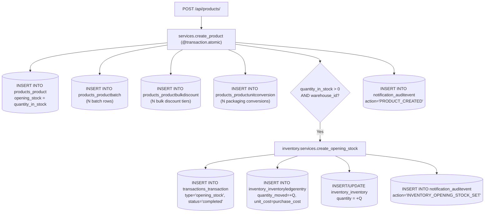

# RIINOX Products App — Interactive Manual Testing Guide & Payload Reference

> **Target Service**: RIINOX Products API (`/api/products/`)  
> **Relevant Specifications**: PRD §6 (Tenancy), §7 (Pricing), §8/§9 (Inventory Ledger), §13/§14 (Product Models), §15/§16 (Opening Stock), §21/§22 (Sales & Stock Integrity), §27/§28/§55 (Financial Costs & Permissions), §31/§60 (Audit Trail & Archival Invariants), §42 (Pagination), §44 (No Hard Deletes).  
> **Audience**: Backend Engineers, QA Engineers, Security Auditors, Frontend Integrators.

---

## 0. Authentication, Context & Database Verification Setup

Before hitting any endpoint, set up your test variables and container shell:

### Environment Variables
```bash
export API_BASE="http://127.0.0.1:8000/api"
export OWNER_TOKEN="<JWT_TOKEN_FOR_ORGANIZATION_OWNER>"
export MANAGER_TOKEN="<JWT_TOKEN_FOR_STORE_MANAGER>"
export SALES_REP_TOKEN="<JWT_TOKEN_FOR_SALES_REPRESENTATIVE>"
export ORG_B_USER_TOKEN="<JWT_TOKEN_FOR_DIFFERENT_TENANT_USER>"

export ORG_A_ID="a1b2c3d4-e5f6-4789-b1c2-d3e4f5a6b7c8"
export ORG_B_ID="99999999-9999-9999-9999-999999999999"
```

### PostgreSQL Direct Inspection Terminal
To inspect the database in real-time before and after hitting endpoints, open a terminal into the PostgreSQL container:
```bash
docker compose -f docker-compose.local.yml exec postgres psql -U riinox -d riinox
```

---

## Endpoint 1: `GET /api/products/` (List Products)

### 1.1 Overview & Purpose
Retrieves a paginated list of catalog products accessible to the authenticated user. Includes nested batch lines, volume tier bulk discounts, packaging unit conversions, and calculated real-time stock balance (`current_stock`).

### 1.2 Request Parameters & Payload Specification
| Parameter | Type | In | Setting Value Effect | Omitting Value Effect | PRD Citation |
| :--- | :--- | :--- | :--- | :--- | :--- |
| `organization` | UUID | Query | Explicitly filters products to the designated organization UUID. User must have active membership in it. | **Default Scoping**: Automatically scopes strictly to the user's current (primary) organization (`user.organization`). | PRD §6, §19 |
| `X-Organization-ID` | UUID | Header | Alternative to query parameter for setting workspace scope. | Defaults to `user.organization`. | PRD §6 |
| `search` | String | Query | Filters products matching `name`, `sku`, or `barcode` (case-insensitive substring). | Returns all products in the scoped tenant. | PRD §13 |
| `page` | Integer | Query | Returns the specified page of results. | Defaults to page `1`. | PRD §42 |

### 1.3 Controlling Code Block
* **View / Queryset Scoping**: [`core/applications/products/api/views.py:20-35`](file:///c:/Users/solomonXuche/Documents/Programming/RIINOX/core/applications/products/api/views.py#L20-L35)
  ```python
  def get_queryset(self):
      user = self.request.user
      if not user.is_authenticated:
          return Product.objects.none()

      qs = Product.objects.for_user(user).with_details()
      org_id = self.request.query_params.get("organization") or self.request.headers.get("X-Organization-ID")
      if org_id:
          return qs.for_organization(org_id)

      # By default scope to current user's organization
      current_org = getattr(user, "organization", None)
      if current_org:
          return qs.for_organization(current_org)

      return qs
  ```
* **Dynamic Cost Redaction**: [`core/applications/products/api/serializers.py:69-80`](file:///c:/Users/solomonXuche/Documents/Programming/RIINOX/core/applications/products/api/serializers.py#L69-L80) & [`lines 10-22`](file:///c:/Users/solomonXuche/Documents/Programming/RIINOX/core/applications/products/api/serializers.py#L10-L22)
  ```python
  def to_representation(self, instance):
      data = super().to_representation(instance)
      request = self.context.get('request')
      user = getattr(request, 'user', None)
      if instance.organization and user and user.is_authenticated:
          if not has_org_permission(user, instance.organization, PermissionCode.VIEW_PRODUCT_COSTS):
              data.pop('purchase_cost', None)
              data.pop('vendor_sale_cost', None)
      return data
  ```

### 1.4 Database Behavior & Mutations
* **Database Mutations**: **Zero**. This is a read-only transaction.
* **SQL Query Executed**:
  ```sql
  SELECT products_product.*, ... 
  FROM products_product 
  WHERE products_product.organization_id = '<current_org_id>'
  ORDER BY products_product.created_at DESC 
  LIMIT 25 OFFSET 0;
  ```
  Prefetches related records in separate queries:
  - `SELECT * FROM products_productbatch WHERE product_id IN (...);`
  - `SELECT * FROM products_productbulkdiscount WHERE product_id IN (...);`
  - `SELECT * FROM products_productunitconversion WHERE product_id IN (...);`

### 1.5 PRD Proof & Business Rationale
* **PRD §6 (Tenant Boundaries)**: Multi-tenancy is strictly isolated. Data never co-mingles across organizations.
* **PRD §55 (Cost Confidentiality)**: Front-line staff (Sales Representatives, Cashiers) must never have visibility into wholesale purchase costs or gross margin metrics.
* **PRD §42 (Standard Pagination)**: All collection endpoints return standardized page envelopes (`count`, `next`, `previous`, `results`).

### 1.6 Ready-to-Run Test Scenarios

#### Scenario 1.1: Owner Lists Products (Default Org Scoping + Full Cost Visibility)
```bash
curl -s -X GET "${API_BASE}/products/" \
  -H "Authorization: Bearer ${OWNER_TOKEN}" | jq .
```
* **Expected Status**: `200 OK`
* **Response Attributes**:
  - `results[].purchase_cost` is **present** (e.g. `"1200.00"`).
  - `results[].vendor_sale_cost` is **present** (e.g. `"1400.00"`).
  - `results[].batches[].cost_price` is **present** (e.g. `"1200.00"`).
  - Results belong strictly to the owner's primary organization.

#### Scenario 1.2: Sales Representative Lists Products (Dynamic Cost Redaction)
```bash
curl -s -X GET "${API_BASE}/products/" \
  -H "Authorization: Bearer ${SALES_REP_TOKEN}" | jq .
```
* **Expected Status**: `200 OK`
* **Response Attributes**:
  - `results[].customer_sale_price` is **present** (e.g. `"2000.00"`).
  - `results[].purchase_cost` is **completely stripped** from the JSON.
  - `results[].vendor_sale_cost` is **completely stripped** from the JSON.
  - `results[].batches[].cost_price` is **completely stripped** from the JSON.

#### Scenario 1.3: Explicit Multi-Tenant Switch (`?organization=<UUID>`)
```bash
curl -s -X GET "${API_BASE}/products/?organization=${ORG_B_ID}" \
  -H "Authorization: Bearer ${OWNER_TOKEN}" | jq .
```
* **Expected Status**: `200 OK`
* **Response Behavior**:
  - If the user holds active membership in Org B: returns Org B's products.
  - If the user is **NOT** a member of Org B: returns `{"count": 0, "results": []}` (zero cross-tenant leakage).

#### Scenario 1.4: Cross-Tenant Intruder Read
```bash
curl -s -X GET "${API_BASE}/products/?organization=${ORG_A_ID}" \
  -H "Authorization: Bearer ${ORG_B_USER_TOKEN}" | jq .
```
* **Expected Status**: `200 OK` with `{"count": 0, "results": []}`.

### 1.7 PostgreSQL Verification Queries
```sql
-- 1. Compare API count with database count for Organization A:
SELECT count(*) AS total_org_a_products 
FROM products_product 
WHERE organization_id = 'a1b2c3d4-e5f6-4789-b1c2-d3e4f5a6b7c8';

-- 2. Verify that costs exist in PostgreSQL even though masked for Sales Reps:
SELECT id, sku, name, purchase_cost, customer_sale_price 
FROM products_product 
WHERE organization_id = 'a1b2c3d4-e5f6-4789-b1c2-d3e4f5a6b7c8'
LIMIT 5;
```

---

## Endpoint 2: `POST /api/products/` (Create Product)

### 2.1 Overview & Purpose
Creates a new product record. Supports nested batch specifications, wholesale volume discount tiers, secondary packaging unit conversions, and atomic provisioning of starting inventory (`opening_stock`) into the immutable inventory ledger.

### 2.2 Payload Field Dictionary & Business Impact

| Field Name | Type | Req? | Setting Field Effect | Omitting Field Effect | PRD Citation |
| :--- | :--- | :---: | :--- | :--- | :--- |
| `organization` | UUID | **Yes** | Scopes product to target organization. Caller must hold active `CREATE_PRODUCT` membership. | **Validation Error (400)**. Required. | PRD §6, §19 |
| `name` | String | **Yes** | Commercial display name. | **Validation Error (400)**. Required. | PRD §13 |
| `sku` | String | **Yes** | Internal Stock Keeping Unit. Enforces `unique_together = (organization, sku)`. | **Validation Error (400)**. Required. | PRD §13 |
| `customer_sale_price` | Decimal | No | Retail selling price. | Defaults to `"0.00"`. | PRD §7, §21 |
| `purchase_cost` | Decimal | No | Unit procurement cost. **Requires `EDIT_PRODUCT_COSTS`**. | Defaults to `"0.00"`. | PRD §7, §55 |
| `vendor_sale_cost` | Decimal | No | Wholesale benchmark. **Requires `EDIT_PRODUCT_COSTS`**. | Defaults to `"0.00"`. | PRD §7, §55 |
| `category` | UUID | No | Links to category. Must belong to same tenant. | Defaults to `null` (uncategorized). | PRD §9, §13 |
| `brand` | UUID | No | Links to brand. Must belong to same tenant. | Defaults to `null`. | PRD §9, §13 |
| `barcode` | String | No | Stores EAN/UPC barcode for POS scanning. | Defaults to `null`. | PRD §13 |
| `track_inventory` | Boolean | No | If `true`: Enforces strict inventory ledger. Overselling blocked in sales. | Defaults to `true`. If `false`: Services/untracked items bypass stock checks. | PRD §13, §15, §22 |
| `track_batches` | Boolean | No | If `true`: Enforces batch numbers and expiry tracking. | Defaults to `false`. | PRD §13, §36 |
| `quantity_in_stock` | Integer | No | Initial stock quantity (write-only). If > 0 and `warehouse_id` passed: provisions opening stock. | Defaults to `0`. No initial inventory rows created. | PRD §15, §16, §42 |
| `warehouse_id` | UUID | No | Target warehouse for opening stock (write-only). Must belong to same tenant. | If omitted, opening stock is skipped. | PRD §15, §35 |
| `batches` | Array | No | Creates child rows in `products_productbatch`. | Defaults to `[]`. | PRD §13, §36 |
| `bulk_discounts` | Array | No | Creates child rows in `products_productbulkdiscount`. | Defaults to `[]`. | PRD §21, §36 |
| `unit_conversions` | Array | No | Creates packaging conversions in `products_productunitconversion`. | Defaults to `[]`. | PRD §13, §14 |

### 2.3 Controlling Code Block
* **Serializer Validation**: [`core/applications/products/api/serializers.py:107-150`](file:///c:/Users/solomonXuche/Documents/Programming/RIINOX/core/applications/products/api/serializers.py#L107-L150)
* **Atomic Service Coordinator**: [`core/applications/products/services.py:43-119`](file:///c:/Users/solomonXuche/Documents/Programming/RIINOX/core/applications/products/services.py#L43-L119)
  ```python
  @transaction.atomic
  def create_product(*, organization, created_by, quantity_in_stock=0, warehouse=None, batches=None, bulk_discounts=None, unit_conversions=None, **product_fields):
      ensure_subscription_active(organization)
      ensure_product_limit(organization)

      if not has_org_permission(created_by, organization, PermissionCode.CREATE_PRODUCT):
          raise PermissionDenied("You do not have permission to create products in this organization.")

      if any(product_fields.get(f) for f in ("purchase_cost", "vendor_sale_cost")):
          if not has_org_permission(created_by, organization, PermissionCode.EDIT_PRODUCT_COSTS):
              raise PermissionDenied("You do not have permission to set product costs.")

      # Multi-tenant foreign key security validation
      for rel, name in [(product_fields.get("category"), "category"), (product_fields.get("brand"), "brand"), (warehouse, "warehouse")]:
          if rel and getattr(rel, "organization_id", None) != organization.id:
              raise ValidationError({name: f"Selected {name} belongs to a different organization."})

      product = Product(organization=organization, created_by=created_by, **product_fields)
      product.clean()
      product.save()

      # Child entities creation
      ...
      # Opening stock provisioning
      if quantity_in_stock > 0 and warehouse:
          create_opening_stock(product=product, warehouse=warehouse, quantity=quantity_in_stock, user=created_by)
      return product
  ```
* **Opening Stock Provisioner**: [`core/applications/inventory/services.py:141-174`](file:///c:/Users/solomonXuche/Documents/Programming/RIINOX/core/applications/inventory/services.py#L141-L174)

### 2.4 Database Mutations & Multi-Table Alterations



| Table Affected | Operation | Columns Written / Values |
| :--- | :---: | :--- |
| `products_product` | `INSERT` | `id`, `organization_id`, `name`, `sku`, `purchase_cost`, `customer_sale_price`, `opening_stock`, `status='active'`. |
| `products_productbatch` | `INSERT` | `id`, `product_id`, `batch_number`, `expiry_date`, `cost_price`, `selling_price`. |
| `products_productbulkdiscount` | `INSERT` | `id`, `product_id`, `min_quantity`, `discount_amount`. |
| `products_productunitconversion`| `INSERT` | `id`, `product_id`, `unit_name`, `multiplier`, `price_override`. |
| `transactions_transaction` | `INSERT` | `id`, `organization_id`, `transaction_type='opening_stock'`, `status='completed'`, `total_amount=0.00`. |
| `inventory_inventoryledgerentry` | `INSERT` | `id`, `product_id`, `warehouse_id`, `quantity_moved=+Q`, `unit_cost=purchase_cost`, `direction='in'`. |
| `inventory_inventory` | `INSERT / UPDATE` | `id`, `product_id`, `warehouse_id`, `quantity = Q`. |
| `notification_auditevent` | `INSERT` | `action='PRODUCT_CREATED'`, `actor_id`, `resource_id`. (Also `INVENTORY_OPENING_STOCK_SET` if stock added). |

### 2.5 PRD Proof & Business Rationale
* **PRD §8 & §15 (Ledger as Source of Truth)**: Opening stock cannot merely edit an integer column; it **must** write an immutable ledger entry (`InventoryLedgerEntry`) and record a financial system transaction (`Transaction`).
* **PRD §13 & §14 (Product Models & Multi-Units)**: Standard support for batches, packaging unit conversions, and volume discount curves.
* **PRD §55 (Cost Permission Separation)**: Setting initial purchase cost is restricted to financial managers (`EDIT_PRODUCT_COSTS`).

### 2.6 Ready-to-Run Test Scenarios

#### Scenario 2.1: Minimal Product (Omitting Optional Fields)
```bash
curl -s -X POST "${API_BASE}/products/" \
  -H "Authorization: Bearer ${OWNER_TOKEN}" \
  -H "Content-Type: application/json" \
  -d '{
    "organization": "'${ORG_A_ID}'",
    "name": "Generic Office Stapler",
    "sku": "OF-STP-001"
  }' | jq .
```
* **Expected Status**: `201 Created`
* **Response / Logic Effect**:
  - `purchase_cost` and `customer_sale_price` default to `"0.00"`.
  - `track_inventory` defaults to `true`.
  - Zero rows inserted into `inventory_inventory`, `transactions_transaction`, or `products_productbatch`.
  - Exactly 1 row inserted into `products_product` and 1 row into `notification_auditevent`.

#### Scenario 2.2: Physical Product with Opening Stock & Warehouse Provisioning
```bash
curl -s -X POST "${API_BASE}/products/" \
  -H "Authorization: Bearer ${OWNER_TOKEN}" \
  -H "Content-Type: application/json" \
  -d '{
    "organization": "'${ORG_A_ID}'",
    "name": "A4 Copy Paper 80gsm Ream",
    "sku": "PAP-A4-80G",
    "unit_of_measurement": "ream",
    "purchase_cost": "3500.00",
    "customer_sale_price": "5000.00",
    "quantity_in_stock": 100,
    "warehouse_id": "<VALID_ORG_A_WAREHOUSE_UUID>"
  }' | jq .
```
* **Expected Status**: `201 Created`
* **Response / Logic Effect**:
  - `opening_stock` is set to `100`.
  - Triggers `create_opening_stock()`. Inspect database to confirm ledger and transaction creation.

#### Scenario 2.3: Perishable Product with Batches & Expiry Dates
```bash
curl -s -X POST "${API_BASE}/products/" \
  -H "Authorization: Bearer ${OWNER_TOKEN}" \
  -H "Content-Type: application/json" \
  -d '{
    "organization": "'${ORG_A_ID}'",
    "name": "Amoxicillin 500mg Capsules",
    "sku": "MED-AMX-500",
    "track_inventory": true,
    "track_batches": true,
    "purchase_cost": "1200.00",
    "customer_sale_price": "2000.00",
    "batches": [
      {
        "batch_number": "AMX-2026-LOT1",
        "expiry_date": "2027-12-31",
        "cost_price": "1200.00",
        "selling_price": "2000.00"
      }
    ]
  }' | jq .
```
* **Expected Status**: `201 Created`
* **Logic Effect**: Inserts 1 row into `products_productbatch` with foreign key to newly created product.

#### Scenario 2.4: Wholesale Product with Bulk Discounts & Secondary Packaging Units
```bash
curl -s -X POST "${API_BASE}/products/" \
  -H "Authorization: Bearer ${OWNER_TOKEN}" \
  -H "Content-Type: application/json" \
  -d '{
    "organization": "'${ORG_A_ID}'",
    "name": "Sparkling Water 500ml",
    "sku": "BEV-SPK-500",
    "customer_sale_price": "300.00",
    "bulk_discounts": [
      {
        "min_quantity": 24,
        "discount_amount": "50.00"
      }
    ],
    "unit_conversions": [
      {
        "unit_name": "Carton (24 Pcs)",
        "multiplier": "24.000",
        "price_override": "6000.00"
      }
    ]
  }' | jq .
```
* **Expected Status**: `201 Created`

#### Scenario 2.5: Untracked Service Item (`track_inventory: false`)
```bash
curl -s -X POST "${API_BASE}/products/" \
  -H "Authorization: Bearer ${OWNER_TOKEN}" \
  -H "Content-Type: application/json" \
  -d '{
    "organization": "'${ORG_A_ID}'",
    "name": "Equipment Inspection & Repair",
    "sku": "SRV-REP-001",
    "product_type": "service",
    "track_inventory": false,
    "customer_sale_price": "15000.00"
  }' | jq .
```
* **Expected Status**: `201 Created`
* **Logic Effect**: Stock validation is permanently bypassed during sales of this item.

#### Scenario 2.6: Permission Failure — Sales Rep Attempts Creation (Blocked)
```bash
curl -s -X POST "${API_BASE}/products/" \
  -H "Authorization: Bearer ${SALES_REP_TOKEN}" \
  -H "Content-Type: application/json" \
  -d '{
    "organization": "'${ORG_A_ID}'",
    "name": "Illicit Item",
    "sku": "ILLICIT-001"
  }' | jq .
```
* **Expected Status**: `403 Forbidden` (`{"detail": "You do not have permission to perform this action."}`)

#### Scenario 2.7: Permission Failure — Manager Attempts Setting Costs (Blocked)
```bash
curl -s -X POST "${API_BASE}/products/" \
  -H "Authorization: Bearer ${MANAGER_TOKEN}" \
  -H "Content-Type: application/json" \
  -d '{
    "organization": "'${ORG_A_ID}'",
    "name": "Manager Product",
    "sku": "MGR-PROD-001",
    "customer_sale_price": "3000.00",
    "purchase_cost": "1800.00"
  }' | jq .
```
* **Expected Status**: `400 Bad Request`
* **Response Body**:
  ```json
  {
    "purchase_cost": ["You do not have permission to edit product costs in this organization."]
  }
  ```

#### Scenario 2.8: Multi-Tenant Foreign Relation Breach (Cross-Org Injection Blocked)
```bash
curl -s -X POST "${API_BASE}/products/" \
  -H "Authorization: Bearer ${OWNER_TOKEN}" \
  -H "Content-Type: application/json" \
  -d '{
    "organization": "'${ORG_A_ID}'",
    "name": "Breach Attempt",
    "sku": "BREACH-001",
    "category": "<ORG_B_CATEGORY_UUID>"
  }' | jq .
```
* **Expected Status**: `400 Bad Request`
* **Response Body**: `{"category": ["Selected category belongs to a different organization."]}`

#### Scenario 2.9: Duplicate SKU within Same Organization (Blocked)
```bash
# Attempt to create product with existing SKU 'OF-STP-001'
curl -s -X POST "${API_BASE}/products/" \
  -H "Authorization: Bearer ${OWNER_TOKEN}" \
  -H "Content-Type: application/json" \
  -d '{
    "organization": "'${ORG_A_ID}'",
    "name": "Another Stapler",
    "sku": "OF-STP-001"
  }' | jq .
```
* **Expected Status**: `400 Bad Request` (`{"sku": ["product with this sku and organization already exists."]}`)

### 2.7 PostgreSQL Verification Queries
```sql
-- 1. Verify product insertion:
SELECT id, name, sku, purchase_cost, customer_sale_price, opening_stock, track_inventory 
FROM products_product WHERE sku = 'PAP-A4-80G';

-- 2. Verify stock ledger entry and inventory balance (for Scenario 2.2):
SELECT id, product_id, warehouse_id, quantity 
FROM inventory_inventory 
WHERE product_id = (SELECT id FROM products_product WHERE sku = 'PAP-A4-80G');

SELECT id, quantity_moved, unit_cost, direction, created_at 
FROM inventory_inventoryledgerentry 
WHERE product_id = (SELECT id FROM products_product WHERE sku = 'PAP-A4-80G');

-- 3. Verify audit event was recorded:
SELECT id, action, actor_id, resource_type, resource_id, created_at 
FROM notification_auditevent 
WHERE resource_id = (SELECT id FROM products_product WHERE sku = 'PAP-A4-80G')::text;
```

---

## Endpoint 3: `GET /api/products/{id}/` (Retrieve Product Details)

### 3.1 Overview & Purpose
Retrieves complete details for a single product. Applies server-side dynamic cost redaction and strict multi-tenant boundary checks.

### 3.2 Request Parameters & Payload Specification
* **Path Parameter**: `id` (UUID) — The primary key of the target product.
* **Request Body**: None.

### 3.3 Controlling Code Block
* **Object Retrieval & Permission Guard**: [`core/applications/products/api/views.py:17-31`](file:///c:/Users/solomonXuche/Documents/Programming/RIINOX/core/applications/products/api/views.py#L17-L31)
* **Cost Masking Logic**: [`core/applications/products/api/serializers.py:69-80`](file:///c:/Users/solomonXuche/Documents/Programming/RIINOX/core/applications/products/api/serializers.py#L69-L80) & [`lines 10-22`](file:///c:/Users/solomonXuche/Documents/Programming/RIINOX/core/applications/products/api/serializers.py#L10-L22)

### 3.4 Database Behavior & Mutations
* **Mutations**: **Zero** (read-only).
* **SQL Query**:
  ```sql
  SELECT products_product.* 
  FROM products_product 
  WHERE products_product.id = '<UUID>' 
    AND products_product.organization_id IN (
        SELECT organization_id FROM users_membership WHERE user_id = '<user_id>' AND is_active = true
    );
  ```

### 3.5 PRD Proof & Business Rationale
* **PRD §6 & §55**: Enforces tenant boundaries (outsiders receive 404, never 403, preventing resource enumeration attacks) and cost field masking.

### 3.6 Ready-to-Run Test Scenarios

#### Scenario 3.1: Retrieve Product as Owner (Full Schema & Visible Costs)
```bash
curl -s -X GET "${API_BASE}/products/<PRODUCT_ID>/" \
  -H "Authorization: Bearer ${OWNER_TOKEN}" | jq .
```
* **Expected Status**: `200 OK`
* **Response Keys**: `purchase_cost` and `vendor_sale_cost` are present with exact values.

#### Scenario 3.2: Retrieve Product as Sales Representative (Costs Masked)
```bash
curl -s -X GET "${API_BASE}/products/<PRODUCT_ID>/" \
  -H "Authorization: Bearer ${SALES_REP_TOKEN}" | jq .
```
* **Expected Status**: `200 OK`
* **Response Keys**: `purchase_cost` and `vendor_sale_cost` are completely absent from the returned JSON.

#### Scenario 3.3: Cross-Tenant Retrieve Intrusion (Tenant B User Accesses Tenant A Product)
```bash
curl -s -X GET "${API_BASE}/products/<PRODUCT_ID>/" \
  -H "Authorization: Bearer ${ORG_B_USER_TOKEN}" | jq .
```
* **Expected Status**: `404 Not Found` (`{"detail": "No Product matches the given query."}`)

### 3.7 PostgreSQL Verification Queries
```sql
-- Confirm actual values in DB remain untouched:
SELECT id, name, sku, purchase_cost, vendor_sale_cost 
FROM products_product WHERE id = '<PRODUCT_ID>';
```

---

## Endpoint 4: `PUT /api/products/{id}/` (Full Update Product)

### 4.1 Overview & Purpose
Performs an idempotent replacement of the product's attributes and nested child relations (`batches`, `bulk_discounts`, `unit_conversions`). Discards opening stock fields (opening stock cannot be modified via update).

### 4.2 Payload Specification & Replacement Logic
* **Full Body**: Must include all required fields (`name`, `sku`, `organization`).
* **Nested Collections Handling**:
  - `bulk_discounts`: Existing discount tiers are deleted and replaced with the new array.
  - `unit_conversions`: Existing conversions are deleted and replaced with the new array.
  - `batches`: Existing batches are matched by `batch_number` and updated; new batch numbers are inserted.

### 4.3 Controlling Code Block
* **Serializer Update Implementation**: [`core/applications/products/api/serializers.py:176-214`](file:///c:/Users/solomonXuche/Documents/Programming/RIINOX/core/applications/products/api/serializers.py#L176-L214)
* **Audit Diff Recorder**: [`core/applications/products/api/views.py:44-68`](file:///c:/Users/solomonXuche/Documents/Programming/RIINOX/core/applications/products/api/views.py#L44-L68)

### 4.4 Database Mutations & Alterations
* `products_product`: Updated fields modified.
* `products_productbulkdiscount`: `DELETE FROM products_productbulkdiscount WHERE product_id = ...;` followed by `INSERT` of new tiers.
* `products_productunitconversion`: `DELETE FROM products_productunitconversion WHERE product_id = ...;` followed by `INSERT` of new units.
* `notification_auditevent`: Emits `PRODUCT_UPDATED` containing `previous_values` and `new_values`.

### 4.5 PRD Proof & Business Rationale
* **PRD §13 & §31**: Preserves audit trails of every commercial revision and configuration change.

### 4.6 Ready-to-Run Test Scenarios

#### Scenario 4.1: Full Update by Owner (Modifying Price, Name & Replacing Discounts)
```bash
curl -s -X PUT "${API_BASE}/products/<PRODUCT_ID>/" \
  -H "Authorization: Bearer ${OWNER_TOKEN}" \
  -H "Content-Type: application/json" \
  -d '{
    "organization": "'${ORG_A_ID}'",
    "name": "A4 Copy Paper 80gsm Ream (Updated Edition)",
    "sku": "PAP-A4-80G",
    "customer_sale_price": "5200.00",
    "purchase_cost": "3500.00",
    "bulk_discounts": [
      {
        "min_quantity": 50,
        "discount_amount": "250.00"
      }
    ]
  }' | jq .
```
* **Expected Status**: `200 OK`

#### Scenario 4.2: Manager Full Update Attempting Cost Modification (Blocked)
```bash
curl -s -X PUT "${API_BASE}/products/<PRODUCT_ID>/" \
  -H "Authorization: Bearer ${MANAGER_TOKEN}" \
  -H "Content-Type: application/json" \
  -d '{
    "organization": "'${ORG_A_ID}'",
    "name": "Tampered Name",
    "sku": "PAP-A4-80G",
    "purchase_cost": "1000.00"
  }' | jq .
```
* **Expected Status**: `400 Bad Request` (`{"purchase_cost": ["You do not have permission to edit product costs in this organization."]}`)

#### Scenario 4.3: Missing Required Field on PUT (Validation Error)
```bash
# PUT omitting 'name'
curl -s -X PUT "${API_BASE}/products/<PRODUCT_ID>/" \
  -H "Authorization: Bearer ${OWNER_TOKEN}" \
  -H "Content-Type: application/json" \
  -d '{"sku": "PAP-A4-80G"}' | jq .
```
* **Expected Status**: `400 Bad Request` (`{"name": ["This field is required."]}`)

### 4.7 PostgreSQL Verification Queries
```sql
SELECT name, customer_sale_price, updated_at FROM products_product WHERE id = '<PRODUCT_ID>';
SELECT min_quantity, discount_amount FROM products_productbulkdiscount WHERE product_id = '<PRODUCT_ID>';
SELECT action, previous_values, new_values FROM notification_auditevent WHERE resource_id = '<PRODUCT_ID>' ORDER BY created_at DESC LIMIT 1;
```

---

## Endpoint 5: `PATCH /api/products/{id}/` (Partial Update Product)

### 5.1 Overview & Purpose
Updates only the explicitly provided subset of fields on a product (e.g. price adjustments, deactivating a product, updating description) without touching other fields or nested collections.

### 5.2 Payload Specification
Submit only the fields you wish to mutate:
```json
{
  "customer_sale_price": "5500.00"
}
```

### 5.3 Controlling Code Block
* **Granular Permission Check**: [`core/applications/products/api/serializers.py:143-150`](file:///c:/Users/solomonXuche/Documents/Programming/RIINOX/core/applications/products/api/serializers.py#L143-L150)
  ```python
  if 'customer_sale_price' in attrs and self.instance:
      if self.instance.customer_sale_price != attrs['customer_sale_price']:
          if not has_org_permission(user, org, PermissionCode.EDIT_SELLING_PRICE):
              raise serializers.ValidationError({
                  'customer_sale_price': 'You do not have permission to edit selling prices in this organization.'
              })
  ```

### 5.4 Database Mutations & Alterations
* Executes an `UPDATE products_product SET <field> = ... WHERE id = ...;` modifying only targeted columns.
* Emits a `PRODUCT_UPDATED` audit record in `notification_auditevent`.

### 5.5 PRD Proof & Business Rationale
* **PRD §21 & §28**: Retail price changes may be carried out by Store Managers (`EDIT_SELLING_PRICE`), while wholesale cost updates remain restricted to Owners and Accountants (`EDIT_PRODUCT_COSTS`).

### 5.6 Ready-to-Run Test Scenarios

#### Scenario 5.1: Store Manager Adjusts Selling Price (Allowed)
```bash
curl -s -X PATCH "${API_BASE}/products/<PRODUCT_ID>/" \
  -H "Authorization: Bearer ${MANAGER_TOKEN}" \
  -H "Content-Type: application/json" \
  -d '{"customer_sale_price": "5600.00"}' | jq .
```
* **Expected Status**: `200 OK`
* **Response**: `customer_sale_price` updated to `"5600.00"`.

#### Scenario 5.2: Store Manager Attempts to Patch Purchase Cost (Blocked)
```bash
curl -s -X PATCH "${API_BASE}/products/<PRODUCT_ID>/" \
  -H "Authorization: Bearer ${MANAGER_TOKEN}" \
  -H "Content-Type: application/json" \
  -d '{"purchase_cost": "2800.00"}' | jq .
```
* **Expected Status**: `400 Bad Request` (`{"purchase_cost": ["You do not have permission to edit product costs in this organization."]}`)

#### Scenario 5.3: Owner Updates Purchase Cost (Allowed)
```bash
curl -s -X PATCH "${API_BASE}/products/<PRODUCT_ID>/" \
  -H "Authorization: Bearer ${OWNER_TOKEN}" \
  -H "Content-Type: application/json" \
  -d '{"purchase_cost": "3700.00"}' | jq .
```
* **Expected Status**: `200 OK`

#### Scenario 5.4: Deactivate Product via Patch
```bash
curl -s -X PATCH "${API_BASE}/products/<PRODUCT_ID>/" \
  -H "Authorization: Bearer ${OWNER_TOKEN}" \
  -H "Content-Type: application/json" \
  -d '{"status": "inactive"}' | jq .
```
* **Expected Status**: `200 OK`

### 5.7 PostgreSQL Verification Queries
```sql
SELECT id, name, customer_sale_price, purchase_cost, status, updated_at 
FROM products_product WHERE id = '<PRODUCT_ID>';
```

---

## Endpoint 6: `DELETE /api/products/{id}/` (Delete or Soft-Archive Product)

### 6.1 Overview & Invariant Architecture
Attempts to delete a product. Evaluates database integrity constraints:
* **Branch A (Clean Delete)**: If the product is clean (never had stock movements, sales, or ledger entries), it is hard-deleted from the database, returning `204 No Content`.
* **Branch B (Protected Archival)**: If the product has historical inventory ledger records or sales transactions, foreign key protection prevents deletion (`ProtectedError`). The system catches the error, automatically flips the product's status to `'archived'`, records an audit event `PRODUCT_ARCHIVED`, and returns `200 OK` with an explanatory message.

### 6.2 Parameters & Body
* **Path Parameter**: `id` (UUID).
* **Request Body**: None.

### 6.3 Controlling Code Block
* **Protected Destroy Handler**: [`core/applications/products/api/views.py:69-94`](file:///c:/Users/solomonXuche/Documents/Programming/RIINOX/core/applications/products/api/views.py#L69-L94)
  ```python
  def destroy(self, request, *args, **kwargs):
      instance = self.get_object()
      context = AuditContext.from_request(request)
      try:
          self.perform_destroy(instance)
          return Response(status=status.HTTP_204_NO_CONTENT)
      except ProtectedError:
          instance.status = ProductStatusChoices.ARCHIVED
          instance.save(update_fields=['status'])
          
          audit_record(
              action=AuditAction.PRODUCT_ARCHIVED,
              organization=instance.organization,
              actor=request.user,
              resource=instance,
              context=context,
              reason="Archived due to existing inventory records preventing deletion."
          )
          return Response(
              {"detail": f"'{instance.name}' has existing inventory records and was archived instead of deleted."},
              status=status.HTTP_200_OK
          )
  ```
* **Permission Enforcement**: Requires `ARCHIVE_PRODUCT` (held by Owner and Administrator; denied to Managers and Sales Reps).

### 6.4 Database Mutations & Alterations
* **On Clean Delete (204)**:
  ```sql
  DELETE FROM products_product WHERE id = '<PRODUCT_ID>';
  ```
  Cascades deletion to `products_productbatch`, `products_productbulkdiscount`, `products_productunitconversion`.
* **On Protected Archival (200)**:
  ```sql
  UPDATE products_product SET status = 'archived' WHERE id = '<PRODUCT_ID>';
  INSERT INTO notification_auditevent (action, actor_id, resource_type, resource_id, reason, ...)
  VALUES ('PRODUCT_ARCHIVED', '<actor_id>', 'products.product', '<PRODUCT_ID>', 'Archived due to existing inventory records...', ...);
  ```

### 6.5 PRD Proof & Business Rationale
* **PRD §44 & §60 (No Hard Deletes of Business History)**: "Financial integrity requires that no ledger movement, inventory historical record, or completed transaction is ever deleted. If an active product has transaction history, it must be archived to protect historical auditing."

### 6.6 Ready-to-Run Test Scenarios

#### Scenario 6.1: Hard Delete of Unused Virgin Product (Clean Delete)
1. Create a product with NO opening stock and NO sales.
2. Execute DELETE:
```bash
curl -s -w "\nHTTP Status: %{http_code}\n" -X DELETE "${API_BASE}/products/<VIRGIN_PRODUCT_ID>/" \
  -H "Authorization: Bearer ${OWNER_TOKEN}"
```
* **Expected Output**:
  ```text
  HTTP Status: 204
  ```

#### Scenario 6.2: Delete Product with Stock History (Soft-Archival Invariant)
1. Target a product that was created with `quantity_in_stock > 0` (e.g. from Scenario 2.2).
2. Execute DELETE:
```bash
curl -s -X DELETE "${API_BASE}/products/<STOCK_PRODUCT_ID>/" \
  -H "Authorization: Bearer ${OWNER_TOKEN}" | jq .
```
* **Expected Status**: `200 OK`
* **Response Body**:
  ```json
  {
    "detail": "'A4 Copy Paper 80gsm Ream' has existing inventory records and was archived instead of deleted."
  }
  ```

#### Scenario 6.3: Manager Attempts Deletion (Permission Blocked)
```bash
curl -s -X DELETE "${API_BASE}/products/<PRODUCT_ID>/" \
  -H "Authorization: Bearer ${MANAGER_TOKEN}" | jq .
```
* **Expected Status**: `403 Forbidden` (`{"detail": "You do not have permission to perform this action."}`)

#### Scenario 6.4: Cross-Tenant Delete Attempt
```bash
curl -s -X DELETE "${API_BASE}/products/<PRODUCT_ID>/" \
  -H "Authorization: Bearer ${ORG_B_USER_TOKEN}" | jq .
```
* **Expected Status**: `404 Not Found`

### 6.7 PostgreSQL Verification Queries
```sql
-- 1. Verify Clean Delete:
SELECT count(*) FROM products_product WHERE id = '<VIRGIN_PRODUCT_ID>';
-- Expected: 0

-- 2. Verify Soft-Archival:
SELECT id, name, sku, status 
FROM products_product WHERE id = '<STOCK_PRODUCT_ID>';
-- Expected: status = 'archived'

-- 3. Verify Archival Audit Log:
SELECT id, action, actor_id, reason, created_at 
FROM notification_auditevent 
WHERE resource_id = '<STOCK_PRODUCT_ID>' AND action = 'PRODUCT_ARCHIVED';
```

---

## 7. Master PostgreSQL Inspection Sandbox

Run these unified inspection scripts in your PostgreSQL terminal to monitor database health and tenant boundaries:

### 7.1 Product 360-Degree Snapshot
```sql
SELECT 
    p.id,
    p.name,
    p.sku,
    p.status,
    p.purchase_cost,
    p.customer_sale_price,
    p.opening_stock,
    COALESCE(SUM(inv.quantity), 0) AS actual_inventory_sum,
    COUNT(DISTINCT pb.id) AS batch_count,
    COUNT(DISTINCT bd.id) AS bulk_discount_count,
    COUNT(DISTINCT uc.id) AS unit_conversion_count
FROM products_product p
LEFT JOIN inventory_inventory inv ON inv.product_id = p.id
LEFT JOIN products_productbatch pb ON pb.product_id = p.id
LEFT JOIN products_productbulkdiscount bd ON bd.product_id = p.id
LEFT JOIN products_productunitconversion uc ON uc.product_id = p.id
WHERE p.organization_id = 'a1b2c3d4-e5f6-4789-b1c2-d3e4f5a6b7c8'
GROUP BY p.id;
```

### 7.2 Complete Ledger Trail for Product
```sql
SELECT 
    ile.created_at,
    ile.quantity_moved,
    ile.direction,
    ile.unit_cost,
    t.transaction_type,
    t.reference_number
FROM inventory_inventoryledgerentry ile
JOIN transactions_transaction t ON t.id = ile.transaction_id
WHERE ile.product_id = '<PRODUCT_ID>'
ORDER BY ile.created_at ASC;
```

### 7.3 Multi-Tenant Boundary Integrity Audit
```sql
-- Confirm ZERO products link to a category or brand from a different organization:
SELECT p.id, p.name, p.organization_id AS prod_org, c.organization_id AS cat_org
FROM products_product p
JOIN products_category c ON c.id = p.category_id
WHERE p.organization_id <> c.organization_id;
-- Expected: 0 rows

SELECT p.id, p.name, p.organization_id AS prod_org, b.organization_id AS brand_org
FROM products_product p
JOIN products_brand b ON b.id = p.brand_id
WHERE p.organization_id <> b.organization_id;
-- Expected: 0 rows
```
