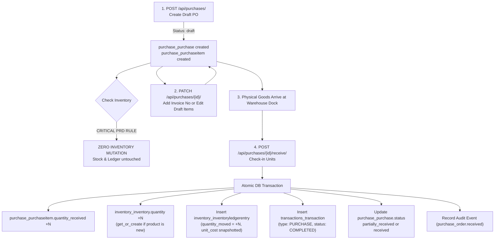

# RIINOX Purchases App — Interactive Manual Testing Guide & Payload Reference

> **Target Service**: RIINOX Purchases API (`/api/purchases/`)  
> **Relevant Specifications**: PRD §10, §16, §18, §42, §44, §52  
> **Target Audience**: QA Engineers, Backend Developers, Frontend Integrators  

---

## 1. Quick Answers to Crucial Payload Questions

> [!IMPORTANT]
> ### 1. Is the `vendor` field optional?
> **NO. The `vendor` field is strictly REQUIRED.**
> * **Backend Enforcement**: In [`Purchase`](file:///c:/Users/solomonXuche/Documents/Programming/RIINOX/core/applications/purchase/models.py#L38-L43), `vendor = auto_prefetch.ForeignKey("vendors.Vendor", on_delete=models.PROTECT)`. There is no `null=True` or `blank=True`.
> * **Business Reason**: A Purchase Order is a legal commercial procurement contract issued to an external supplier. In B2B wholesale, an order cannot exist without an identified supplier entity.
> * **Validation Result**: Omitting `"vendor"` returns HTTP `400 Bad Request`: `{"vendor": ["This field is required."]}`.

> [!TIP]
> ### 2. Does `product` have to already exist in our warehouse inventory?
> **NO. The product does NOT need to already exist in the warehouse inventory.**
> * **Catalog vs. Warehouse**: The product UUID must exist in the organization's **Product Catalog** ([`products.Product`](file:///c:/Users/solomonXuche/Documents/Programming/RIINOX/core/applications/products/models.py)), but does **not** need an existing row in that warehouse's [`Inventory`](file:///c:/Users/solomonXuche/Documents/Programming/RIINOX/core/applications/inventory/models.py) table.
> * **Auto-Creation on Receiving**: When physical stock arrives and you call `/api/purchases/{id}/receive/`, the backend runs [`Inventory.objects.get_or_create(...)`](file:///c:/Users/solomonXuche/Documents/Programming/RIINOX/core/applications/inventory/services.py#L441-L445). If the warehouse has never stocked this product before, an inventory record starting at 0 is automatically created and incremented by the received quantity.
> * **Zero Stock Mutation on Creation (PRD §16 & §18)**: Creating a PO (`POST /api/purchases/`) does **not** check warehouse stock or modify inventory in any way.

> [!NOTE]
> ### 3. What do `other_costs` and `discount` do, and why should the buyer set them?
> * **`other_costs` (Landed Costs / Freight / Waybill)**:
>   * Records supplier-billed charges beyond item prices: shipping, freight, courier fees, customs duty, port clearance, or handling.
>   * In B2B wholesale, suppliers invoice freight directly on the PO or pro-forma invoice. Setting `other_costs` guarantees that the purchase order total matches the vendor's invoice so Accounts Payable can reconcile payments without discrepancies.
> * **`discount` (Order-Level Discount)**:
>   * Records negotiated global commercial discounts (e.g. bulk buying reduction, promotional concession, vendor loyalty discount).
> * **Mathematical Impact**:
>   $$\text{ordered\_value} = \sum(\text{Line Item Cost} \times \text{Quantity}) + \text{other\_costs} - \text{discount}$$

---

## 2. Comprehensive Payload Field Dictionary

### 2.1 Purchase Order Header (`POST /api/purchases/` & `PUT /api/purchases/{id}/`)

| Field Name | Type | Required? | Default | Source / Where to get UUID | Purpose & Business Rules |
| :--- | :--- | :--- | :--- | :--- | :--- |
| **`organization`** | `UUID` | **Required** | None | `GET /api/users/organizations/` | Multi-tenant tenant boundary. The authenticated user must belong to this organization. |
| **`vendor`** | `UUID` | **Required** | None | `GET /api/vendors/` | Must be an existing Vendor belonging to the same organization. |
| **`warehouse`** | `UUID` | **Required** | None | `GET /api/warehouse/warehouses/` | Destination warehouse where physical goods will be stocked upon arrival. |
| **`items`** | `Array` | **Required** | `[]` | Array of Line Item objects | Line items ordered from the vendor. Must have at least 1 item for a meaningful PO. |
| **`other_costs`** | `Decimal` (String) | Optional | `"0.00"` | Vendor invoice / freight quote | Landed freight, waybill, handling, or customs charges added to the order total. |
| **`discount`** | `Decimal` (String) | Optional | `"0.00"` | Negotiated vendor discount | Order-level commercial deduction subtracted from the order total. |
| **`order_date`** | `Date` (YYYY-MM-DD) | Optional | `null` | Order placement date | Calendar date the purchase order was issued/negotiated with the supplier. |
| **`delivery_date`** | `Date` (YYYY-MM-DD) | Optional | `null` | Expected arrival date | Target delivery ETA. Used by warehouse staff for dock schedule planning. |
| **`delivery_method`** | `String` | Optional | `""` | Free text | Logistics arrangement (e.g., `"Supplier Delivery"`, `"Warehouse Pickup"`, `"DHL Freight"`). |
| **`vendor_invoice_number`** | `String` | Optional | `""` | Vendor paper invoice | Reference code on the supplier's commercial invoice (e.g., `"INV-2026-8910"`). |
| **`supporting_document`** | `File` (Binary) | Optional | `null` | File upload | Scanned PDF or photo of vendor quotation, waybill, or delivery note. |
| **`notes`** | `String` | Optional | `""` | Free text | Internal procurement remarks, payment terms, or special receiving dock instructions. |
| **`ordered_by`** | `UUID` | Optional | Logged-in user | `request.user` | Purchasing staff member. Automatically defaults to the logged-in user if omitted. |

---

### 2.2 Line Item Object (`items[...]`)

| Field Name | Type | Required? | Default | Source / Where to get UUID | Purpose & Business Rules |
| :--- | :--- | :--- | :--- | :--- | :--- |
| **`product`** | `UUID` | **Required** | None | `GET /api/products/products/` | Product from catalog. **Does NOT need to be in warehouse already.** |
| **`quantity_ordered`** | `Integer` | **Required** | None | User input | Number of units ordered. Must be an integer `>= 1`. |
| **`purchase_cost`** | `Decimal` (String) | **Required** | None | Supplier unit quote | Agreed unit purchase price. **Snapshotted permanently** on [`PurchaseItem`](file:///c:/Users/solomonXuche/Documents/Programming/RIINOX/core/applications/purchase/models.py#L150) so future price catalog changes never rewrite history. |
| **`discount`** | `Decimal` (String) | Optional | `"0.00"` | Supplier line concession | Line-level discount deducted specifically from this item line's total. |
| **`variant`** | `UUID` | Optional | `null` | `GET /api/products/variants/` | Specific product variant (e.g. Size/Color). Leave `null` for simple products. |
| **`unit`** | `UUID` | Optional | `null` | `GET /api/products/units/` | Unit conversion if ordered in packaging multiples (e.g. Carton of 24). Leave `null` for base unit. |

---

## 3. Procurement Lifecycle & Database Mutation Map



---

## 4. End-to-End Manual Testing Walkthrough

Follow these 5 testing steps using cURL, Postman, or Swagger UI (`http://127.0.0.1:8000/api/docs/`).

### Step 1: Create a Purchase Order (`POST /api/purchases/`)

#### Request:
```bash
curl -X POST "http://127.0.0.1:8000/api/purchases/" \
  -H "Authorization: Bearer <ACCESS_TOKEN>" \
  -H "Content-Type: application/json" \
  -d '{
    "organization": "a1b2c3d4-e5f6-4789-b1c2-d3e4f5a6b7c8",
    "vendor": "f1e2d3c4-b5a6-4789-b1c2-d3e4f5a6b7c8",
    "warehouse": "c1d2e3f4-a5b6-4789-b1c2-d3e4f5a6b7c8",
    "delivery_method": "Supplier Delivery",
    "other_costs": "5000.00",
    "discount": "1000.00",
    "order_date": "2026-10-09",
    "delivery_date": "2026-10-15",
    "notes": "Restocking core warehouse items.",
    "items": [
      {
        "product": "d1e2f3a4-b5c6-4789-b1c2-d3e4f5a6b7c8",
        "quantity_ordered": 100,
        "purchase_cost": "2500.00",
        "discount": "0.00"
      }
    ]
  }'
```

#### Expected HTTP Response:
* **Status**: `201 Created`
* **Response Body**:
```json
{
  "id": "7b1deb4d-3b7d-4bad-9bdd-2b0d7b3dcb6d",
  "purchase_number": "PO-2026-0001",
  "status": "draft",
  "ordered_value": "254000.00",
  "total_value": "4000.00",
  "items": [
    {
      "id": "8c2deb4d-4c8d-5cae-acde-3c1e8c4dcb7e",
      "product": "d1e2f3a4-b5c6-4789-b1c2-d3e4f5a6b7c8",
      "quantity_ordered": 100,
      "quantity_received": 0,
      "purchase_cost": "2500.00",
      "ordered_value": "250000.00",
      "received_value": "0.00"
    }
  ]
}
```

#### Database State Verification:
Execute in PostgreSQL container (`docker compose -f docker-compose.local.yml exec postgres psql -U riinox -d riinox`):
```sql
-- 1. Verify PO header in draft status with correct sequence number
SELECT id, purchase_number, status, other_costs, discount 
FROM purchase_purchase WHERE id = '7b1deb4d-3b7d-4bad-9bdd-2b0d7b3dcb6d';

-- 2. Verify Line Item with quantity_received = 0
SELECT id, product_id, quantity_ordered, quantity_received, purchase_cost 
FROM purchase_purchaseitem WHERE purchase_id = '7b1deb4d-3b7d-4bad-9bdd-2b0d7b3dcb6d';

-- 3. CRITICAL INVENTORY VERIFICATION (Zero Stock Mutation):
SELECT quantity FROM inventory_inventory 
WHERE product_id = 'd1e2f3a4-b5c6-4789-b1c2-d3e4f5a6b7c8' 
  AND warehouse_id = 'c1d2e3f4-a5b6-4789-b1c2-d3e4f5a6b7c8';
-- Expected: Stock is UNCHANGED. No rows inserted in inventory_inventoryledgerentry!
```

---

### Step 2: Partial Goods Receipt (`POST /api/purchases/{id}/receive/`)

Suppose the vendor delivers the first batch of 40 units out of 100 ordered.

#### Request:
```bash
curl -X POST "http://127.0.0.1:8000/api/purchases/7b1deb4d-3b7d-4bad-9bdd-2b0d7b3dcb6d/receive/" \
  -H "Authorization: Bearer <ACCESS_TOKEN>" \
  -H "Content-Type: application/json" \
  -d '{
    "items_received": [
      {
        "item_id": "8c2deb4d-4c8d-5cae-acde-3c1e8c4dcb7e",
        "quantity_received": 40
      }
    ]
  }'
```

#### Expected HTTP Response:
* **Status**: `200 OK`
* **Response Body**:
```json
{
  "status": "received",
  "purchase_status": "partially_received",
  "items_received_count": 1
}
```

#### Database State Verification:
```sql
-- 1. Verify PO status transitioned to partially_received
SELECT status, received_by_id FROM purchase_purchase 
WHERE id = '7b1deb4d-3b7d-4bad-9bdd-2b0d7b3dcb6d';
-- Expected: status = 'partially_received', received_by_id = <logged_in_user_uuid>

-- 2. Verify line item received count is 40
SELECT quantity_ordered, quantity_received FROM purchase_purchaseitem 
WHERE id = '8c2deb4d-4c8d-5cae-acde-3c1e8c4dcb7e';
-- Expected: quantity_ordered = 100, quantity_received = 40

-- 3. Verify warehouse stock incremented by exactly 40
SELECT quantity FROM inventory_inventory 
WHERE product_id = 'd1e2f3a4-b5c6-4789-b1c2-d3e4f5a6b7c8' 
  AND warehouse_id = 'c1d2e3f4-a5b6-4789-b1c2-d3e4f5a6b7c8';
-- Expected: Exactly 40 units added to previous inventory balance!

-- 4. Verify immutable ledger entry
SELECT transaction_id, quantity_moved, unit_cost, warehouse_id 
FROM inventory_inventoryledgerentry 
WHERE product_id = 'd1e2f3a4-b5c6-4789-b1c2-d3e4f5a6b7c8' 
ORDER BY created_at DESC LIMIT 1;
-- Expected: quantity_moved = 40, unit_cost = 2500.00
```

---

### Step 3: Order Updates & Product Revisions (`PATCH /api/purchases/{id}/`)

#### 3.1 Revising Products & Line Items on a Draft Order (Allowed)
Before any physical goods arrive (`quantity_received == 0`), you can freely update line items, product quantities, or negotiated costs:
```bash
curl -X PATCH "http://127.0.0.1:8000/api/purchases/7b1deb4d-3b7d-4bad-9bdd-2b0d7b3dcb6d/" \
  -H "Authorization: Bearer <ACCESS_TOKEN>" \
  -H "Content-Type: application/json" \
  -d '{
    "notes": "Updated line items: increased quantity and added second product per revised vendor quote.",
    "items": [
      {
        "product": "d1e2f3a4-b5c6-4789-b1c2-d3e4f5a6b7c8",
        "quantity_ordered": 150,
        "purchase_cost": "2400.00",
        "discount": "200.00"
      },
      {
        "product": "c4d5e6f7-a8b9-4789-b1c2-d3e4f5a6b7c8",
        "quantity_ordered": 75,
        "purchase_cost": "1150.00",
        "discount": "50.00"
      }
    ]
  }'
```
* **Expected Response**: `200 OK` with updated `items` array, recalculated `ordered_value`.

#### 3.2 Attempting to Update Products After Receiving Goods (Strictly Blocked)
> [!WARNING]
> **PRD §18 & §44 Immutability Rule:**
> Once goods have been checked in (`quantity_received > 0`), modifying the `items` array is blocked:
```bash
curl -X PATCH "http://127.0.0.1:8000/api/purchases/7b1deb4d-3b7d-4bad-9bdd-2b0d7b3dcb6d/" \
  -H "Authorization: Bearer <ACCESS_TOKEN>" \
  -H "Content-Type: application/json" \
  -d '{
    "items": [
      {
        "product": "d1e2f3a4-b5c6-4789-b1c2-d3e4f5a6b7c8",
        "quantity_ordered": 200,
        "purchase_cost": "2000.00"
      }
    ]
  }'
```
* **Expected Response**: `400 Bad Request`: `["Cannot modify line items on a purchase order that has already received goods."]`

#### 3.3 Updating Non-Item Header Metadata (Always Allowed)
Updating headers (such as `notes`, `vendor_invoice_number`, or `delivery_date`) succeeds with `200 OK`:
```bash
curl -X PATCH "http://127.0.0.1:8000/api/purchases/7b1deb4d-3b7d-4bad-9bdd-2b0d7b3dcb6d/" \
  -H "Authorization: Bearer <ACCESS_TOKEN>" \
  -H "Content-Type: application/json" \
  -d '{
    "vendor_invoice_number": "INV-2026-9901",
    "notes": "First batch arrived safely; second batch due next Tuesday."
  }'
```

---

### Step 4: Complete Remaining Receipt (`POST /api/purchases/{id}/receive/`)

Now check in the final 60 units.

#### Request:
```bash
curl -X POST "http://127.0.0.1:8000/api/purchases/7b1deb4d-3b7d-4bad-9bdd-2b0d7b3dcb6d/receive/" \
  -H "Authorization: Bearer <ACCESS_TOKEN>" \
  -H "Content-Type: application/json" \
  -d '{
    "items_received": [
      {
        "item_id": "8c2deb4d-4c8d-5cae-acde-3c1e8c4dcb7e",
        "quantity_received": 60
      }
    ]
  }'
```

#### Expected HTTP Response:
* **Status**: `200 OK`
* **Response Body**:
```json
{
  "status": "received",
  "purchase_status": "received",
  "items_received_count": 1
}
```

#### Database State Verification:
```sql
-- 1. Status is now fully 'received'
SELECT status FROM purchase_purchase WHERE id = '7b1deb4d-3b7d-4bad-9bdd-2b0d7b3dcb6d';
-- Expected: status = 'received'

-- 2. Line item quantity_received equals quantity_ordered
SELECT quantity_ordered, quantity_received FROM purchase_purchaseitem 
WHERE id = '8c2deb4d-4c8d-5cae-acde-3c1e8c4dcb7e';
-- Expected: quantity_ordered = 100, quantity_received = 100
```

---

### Step 5: Deletion Safeguard Verification (`DELETE /api/purchases/{id}/`)

> [!CAUTION]
> **PRD §18 Deletion Safeguard:**
> Received purchase orders can NEVER be deleted, because inventory ledgers and physical stock depend on them.

#### Request:
```bash
curl -X DELETE "http://127.0.0.1:8000/api/purchases/7b1deb4d-3b7d-4bad-9bdd-2b0d7b3dcb6d/" \
  -H "Authorization: Bearer <ACCESS_TOKEN>"
```

#### Expected HTTP Response:
* **Status**: `400 Bad Request`
* **Response Body**:
```json
{
  "code": "CANNOT_DELETE_RECEIVED_PURCHASE",
  "detail": "Cannot delete a purchase order that has already received goods. Cancel it instead."
}
```

---

## 5. PRD Edge Cases & QA Test Matrix

Use this checklist during manual API or automated regression testing:

| [x] | Test Scenario | HTTP Method & Payload | Expected Status | Verification Criteria |
| :---: | :--- | :--- | :---: | :--- |
| [ ] | **Missing Vendor** | `POST /api/purchases/` with `"vendor": null` or omitted | `400 Bad Request` | Body: `{"vendor": ["This field is required."]}`. |
| [ ] | **Missing Warehouse** | `POST /api/purchases/` with `"warehouse": null` | `400 Bad Request` | Body: `{"warehouse": ["This field is required."]}`. |
| [ ] | **Brand New Product** | `POST` with product not yet in warehouse, then `/receive/` | `200 OK` | `Inventory` row created via `get_or_create` with stock equal to received units. |
| [ ] | **Zero Stock on Creation** | `POST /api/purchases/` | `201 Created` | DB query confirms 0 change in `inventory_inventory` and 0 rows in ledger. |
| [ ] | **Negative Quantity** | `POST /api/purchases/` with `quantity_ordered: -5` | `400 Bad Request` | Rejected by DRF validation. |
| [ ] | **Negative Cost** | `POST /api/purchases/` with `purchase_cost: -50.00` | `400 Bad Request` | Rejected by DRF validation. |
| [ ] | **Over-Receiving** | `POST /receive/` with `quantity_received: 101` on 100 ordered | `400 Bad Request` | Error: `"Cannot receive 101 units... Already received 0 of 100 ordered"`. Stock untouched. |
| [ ] | **Zero Quantity Received** | `POST /receive/` with `quantity_received: 0` | `400 Bad Request` | Error: `"Received quantity must be greater than zero"`. |
| [ ] | **Receive on Cancelled PO** | Cancel PO, then call `/receive/` | `400 Bad Request` | Error: `"Cannot receive goods against a cancelled purchase order"`. |
| [ ] | **Delete Unreceived Draft** | `DELETE /api/purchases/{id}/` when `quantity_received == 0` | `204 No Content` | PO and its items deleted from DB. |
| [ ] | **Delete Received PO** | `DELETE /api/purchases/{id}/` when `quantity_received > 0` | `400 Bad Request` | Error code: `CANNOT_DELETE_RECEIVED_PURCHASE`. PO preserved. |
| [ ] | **Modify Items after Receipt**| `PATCH /api/purchases/{id}/` with new `items` array | `400 Bad Request` | Error: `"Cannot modify line items on a purchase order that has already received goods."` |
| [ ] | **Multi-Tenant Isolation** | Query PO with Org B user token | `404 Not Found` | Tenant boundary prevents cross-organization PO access. |

---

## 6. Database Schema Reference

```text
purchase_purchase
├── id (UUID, PK)
├── organization_id (UUID -> users_organization)
├── purchase_number (VARCHAR(30), UNIQUE, e.g. 'PO-2026-0001')
├── vendor_id (UUID -> vendors_vendor) [REQUIRED]
├── warehouse_id (UUID -> warehouse_warehouse) [REQUIRED]
├── ordered_by_id (UUID -> users_user)
├── received_by_id (UUID -> users_user, NULL until received)
├── status (VARCHAR(20), 'draft' | 'ordered' | 'partially_received' | 'received' | 'cancelled')
├── other_costs (NUMERIC(12,2), default 0.00)
├── discount (NUMERIC(12,2), default 0.00)
├── delivery_method (VARCHAR(100))
├── delivery_date (DATE)
└── order_date (DATE)

purchase_purchaseitem
├── id (UUID, PK)
├── purchase_id (UUID -> purchase_purchase, CASCADE)
├── product_id (UUID -> products_product) [REQUIRED]
├── variant_id (UUID -> products_productvariant, NULL)
├── unit_id (UUID -> products_productunitconversion, NULL)
├── quantity_ordered (INT, >= 1)
├── quantity_received (INT, default 0)
├── purchase_cost (NUMERIC(12,2)) [Snapshotted unit price]
└── discount (NUMERIC(12,2), default 0.00)
```
